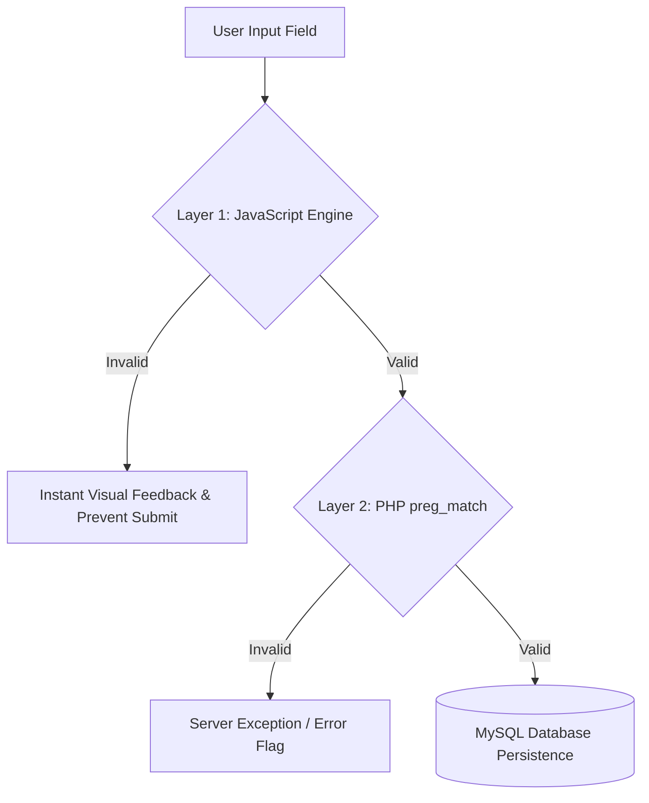

# IEEE 829 Software Test Plan (STP)
## Project: COVID-19 Dynamic Information & Appointment Portal

---

### 1. Test Plan Identifier
- **Document Ref:** `STQA-STP-COVID-2026-V1.0`
- **Project Title:** COVID-19 Dynamic Portal & Verification System
- **Subject:** Software Testing & Quality Assurance (STQA)

---

### 2. References
- IEEE Standard 829-2008 for Software Test Documentation.
- RFC 5322 Standard for Electronic Mail Format Specification.
- OWASP Top 10 Web Application Security Risks (Input Validation & Injection Prevention).

---

### 3. Introduction & Purpose
The purpose of this Test Plan is to outline the scope, strategy, resource allocation, and schedule for testing the dynamic COVID-19 Information and Slot Booking website. 
The system provides public health awareness, real-time statistics, citizen account management, vaccination/RT-PCR appointment registration, and community forums.

The central QA focus is **rigorous verification of user input using Regular Expressions (Regex)** at both the presentation layer (JavaScript) and business logic layer (PHP), evaluated via Black-Box testing techniques.

---

### 4. Test Items (Scope)
The following software modules are targeted for testing:
1. **Module 1 (M1): Public Awareness & Dynamic Metrics Hub (`index.php`)**
   - Counter animations and accurate display of live infection and vaccination statistics.
2. **Module 2 (M2): Citizen Authentication & Account Management (`signup.php`, `login.php`, `logout.php`, `dashboard.php`)**
   - User registration, password complexity validation, secure bcrypt hashing, session persistence.
3. **Module 3 (M3): Vaccination & RT-PCR Slot Registration (`register_slot.php`)**
   - Multi-field appointment booking with strict regular expression and boundary value checks.
4. **Module 4 (M4): Community Feedback & Q&A Forum (`comments.php`, `admin.php`)**
   - User feedback submission, XSS input sanitization, and administrative moderation.
5. **Module 5 (M5): Interactive STQA Test Runner (`test_runner.php`)**
   - Automated test execution engine with live Pass/Fail verification and metric logging.

---

### 5. Features to be Tested vs Not Tested
#### Features to be Tested:
- Client-side real-time regex matching and error messaging.
- Server-side double-checking via `preg_match()`.
- Boundary Value Analysis (BVA) on text lengths (Name, Password) and numeric limits (Age, Pincode).
- Equivalence Class Partitioning (ECP) across valid and invalid partitions.
- Session authorization and Access Control (protecting `admin.php` and `dashboard.php`).
- Cross-Site Scripting (XSS) and SQL injection vulnerability prevention.

#### Features Not to be Tested:
- Payment gateway integration (all COVID health services are public/free).
- External high-load performance testing (> 100,000 concurrent RPS).

---

### 6. Testing Methodologies & Strategy

1. **Equivalence Partitioning (EP):** Dividing input domains into valid and invalid classes to minimize test case redundancy while maximizing defect detection.
2. **Boundary Value Analysis (BVA):** Exercising boundaries ($Min - 1$, $Min$, $Max$, $Max + 1$) on name length, password characters, age limits, and pincode digits.
3. **Dual-Tier Validation:** Proving that bypassing JavaScript (e.g. by disabling JS in browser) will not compromise data integrity because the server layer enforces identical regular expression constraints.
4. **Automated Regression Suite:** Utilizing `test_runner.php` to run 50+ pre-defined test cases in batch.

---

### 7. Item Pass / Fail Criteria
- **Pass Criteria:**
  - Valid input classes are recognized and processed with positive status ($200\text{ OK}$ / Accepted).
  - Invalid input classes are rejected before database commit with appropriate error notifications.
  - Zero unhandled exceptions or PHP fatal errors during malformed payload injection.
- **Fail Criteria:**
  - An invalid format (e.g. invalid email or underage appointment) bypasses validation and commits to the database.
  - The application crashes or exhibits unhandled database connection errors.

---

### 8. Environmental Needs
- **Operating Environment:** Windows / macOS / Linux.
- **Web Server:** Apache / Nginx / PHP 8.x Built-in Development Server.
- **Database:** MySQL 5.7+ / MariaDB 10.4+.
- **Client Browsers:** Google Chrome, Mozilla Firefox, Microsoft Edge.

---

### 9. Deliverables
1. Software Test Plan (this document).
2. Test Case Specification Table (`testing/test_cases.md`).
3. Automated Test Execution Engine (`test_runner.php`).
4. Requirements Traceability Matrix (RTM).
5. Defect / Bug Tracking Log (`testing/defect_log.md`).
